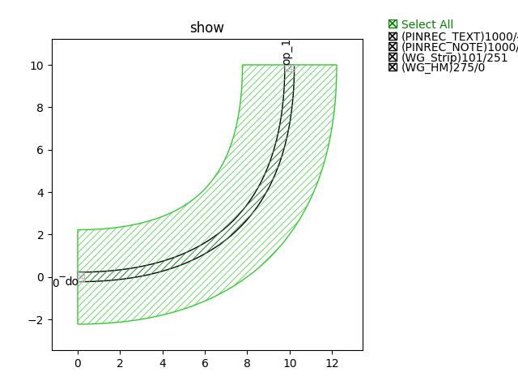
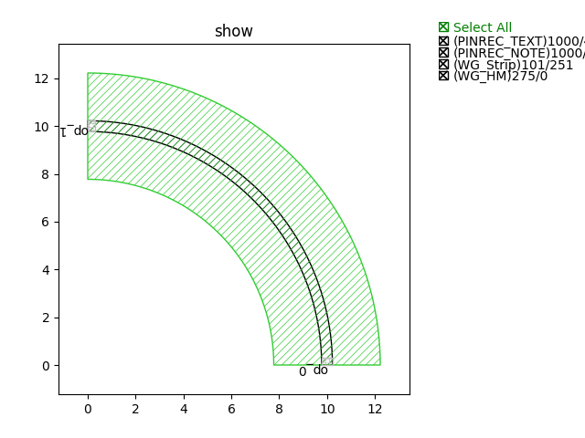
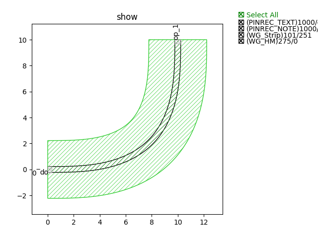

Bend
#############################

BendBezier
**********************************************************

+----------------+------------------------------------------------------------------------------------------------------+
| Parameters     | Description                                                                                          |
+================+======================================================================================================+
|start           | Position where bend start, eg. (x, y)                                                                |
+----------------+------------------------------------------------------------------------------------------------------+
|controls        | Control points, count >= 1, eg. [(x1, y1), (x2, y2)]                                                 |
+----------------+------------------------------------------------------------------------------------------------------+
|end             | Position where bend end, eg. (x, y)                                                                  |
+----------------+------------------------------------------------------------------------------------------------------+

+-------------------+-----------------------------+-------------+
|     ports         |   default waveguide type    | orientation |
+===================+=============================+=============+
| op_0              | TECH.WG.STRIP.C.WIRE        | 180         |
+-------------------+-----------------------------+-------------+
| op_1              | TECH.WG.STRIP.C.WIRE        | 90          |
+-------------------+-----------------------------+-------------+

BendCircular
**********************************************************

+----------------+-----------------+------------------------------------------------------------------------------------+
| Parameters     | Range           | Description                                                                        |
+================+=================+====================================================================================+
|degrees         | (-180, 180)     | Bend angle in degrees                                                              |
+----------------+-----------------+------------------------------------------------------------------------------------+
|radius          |  > 0            | Bend radius                                                                        |
+----------------+-----------------+------------------------------------------------------------------------------------+

+-------------------+-----------------------------+-------------+
|     ports         |   default waveguide type    | orientation |
+===================+=============================+=============+
| op_0              | TECH.WG.STRIP.C.WIRE        | 180         |
+-------------------+-----------------------------+-------------+
| op_1              | TECH.WG.STRIP.C.WIRE        | 90          |
+-------------------+-----------------------------+-------------+

BendEuler
**********************************************************

+----------------+-----------------+------------------------------------------------------------------------------------+
| Parameters     | Range           | Description                                                                        |
+================+=================+====================================================================================+
|degrees         | (-180, 180)     | Bend angle in degrees                                                              |
+----------------+-----------------+------------------------------------------------------------------------------------+
|radius_eff      |  > 0            | Radius effective                                                                   |
+----------------+-----------------+------------------------------------------------------------------------------------+
|radius_min      |  > 0            | Radius minimum                                                                     |
+----------------+-----------------+------------------------------------------------------------------------------------+
|p               |  (0, 1]         | Radio of euler spiral in whole bend                                                |
+----------------+-----------------+------------------------------------------------------------------------------------+
|l_max           |  > 0            | Max length of euler spiral in half bend                                            |
+----------------+-----------------+------------------------------------------------------------------------------------+
|degrees_max     |  > 0            | Max angle of euler spiral part in half bend                                        |
+----------------+-----------------+------------------------------------------------------------------------------------+

+-------------------+-----------------------------+-------------+
|     ports         |   default waveguide type    | orientation |
+===================+=============================+=============+
| op_0              | TECH.WG.STRIP.C.WIRE        | 180         |
+-------------------+-----------------------------+-------------+
| op_1              | TECH.WG.STRIP.C.WIRE        | 90          |
+-------------------+-----------------------------+-------------+
