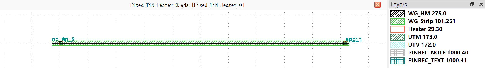

Fixed Heater
#############################

    The fixed component is still in the development stage, so its performance cannot be guaranteed.
    Specific performance will be subject to the measured data.

Fixed_TiN_Heater_O
*******************************************

+-------------------+-----------------------------+------------------------+-------------+
|     ports         | waveguide type              | position               | orientation |
+===================+=============================+========================+=============+
| op_0              | TECH.WG.STRIP.O.WIRE        | (-265, 0)              | 180         |
+-------------------+-----------------------------+------------------------+-------------+
| op_1              | TECH.WG.STRIP.O.WIRE        | (265, 0)               | 0           |
+-------------------+-----------------------------+------------------------+-------------+

+-------------------+-----------------------------+------------------------+-------------+
|     pins          | metal line type             | position               | orientation |
+===================+=============================+========================+=============+
| ep_0              | TECH.METAL.M1.W10           | (-248.1, 0)            | 90          |
+-------------------+-----------------------------+------------------------+-------------+
| ep_1              | TECH.METAL.M1.W10           | (258.1, 0)             | 90          |
+-------------------+-----------------------------+------------------------+-------------+
