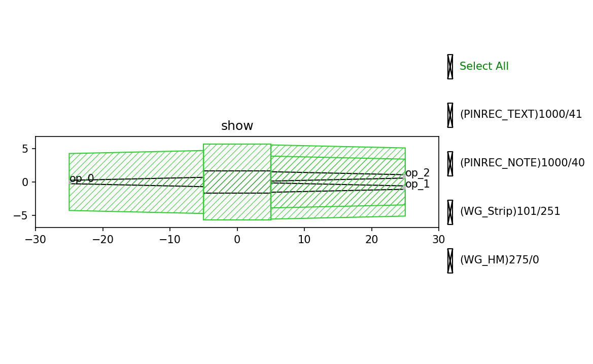

Fixed Mmi
#############################

    The fixed component is still in the development stage, so its performance cannot be guaranteed.
    Specific performance will be subject to the measured data.

FixedMMI_1X2_C
*******************************************

+-------------------+-----------------------------+------------------------+-------------+
|     ports         | waveguide type              | position               | orientation |
+===================+=============================+========================+=============+
| op_0              | TECH.WG.STRIP.C.WIRE        | (-25, 0)               | 180         |
+-------------------+-----------------------------+------------------------+-------------+
| op_1              | TECH.WG.STRIP.C.WIRE        | (25, -0.835)           | 0           |
+-------------------+-----------------------------+------------------------+-------------+
| op_2              | TECH.WG.STRIP.C.WIRE        | (25, 0.835)            | 0           |
+-------------------+-----------------------------+------------------------+-------------+
