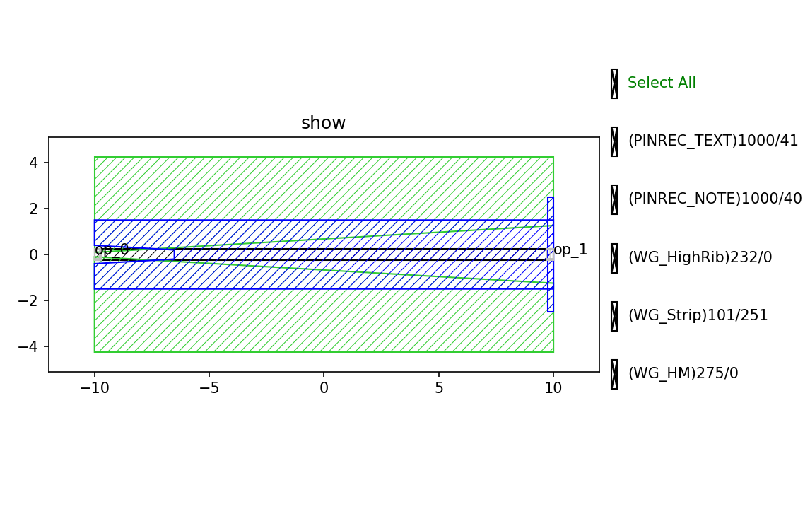
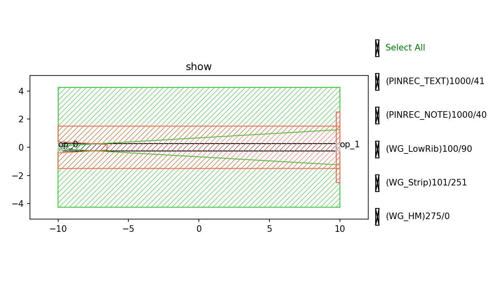

Fixed Transition
#############################

    The fixed component is still in the development stage, so its performance cannot be guaranteed.
    Specific performance will be subject to the measured data.

Fixed_Transition_Strip_HighRib_C
*******************************************

+-------------------+-----------------------------+------------------------+-------------+
|     ports         | waveguide type              | position               | orientation |
+===================+=============================+========================+=============+
| op_0              | TECH.WG.STRIP.C.WIRE        | (-10, 0)               | 180         |
+-------------------+-----------------------------+------------------------+-------------+
| op_1              | TECH.WG.HRIB.C.WIRE         | (10, 0)                | 0           |
+-------------------+-----------------------------+------------------------+-------------+

Fixed_Transition_Strip_LowRib_C
*******************************************

+-------------------+-----------------------------+------------------------+-------------+
|     ports         | waveguide type              | position               | orientation |
+===================+=============================+========================+=============+
| op_0              | TECH.WG.STRIP.C.WIRE        | (-10, 0)               | 180         |
+-------------------+-----------------------------+------------------------+-------------+
| op_1              | TECH.WG.LRIB.C.WIRE         | (10, 0)                | 0           |
+-------------------+-----------------------------+------------------------+-------------+
