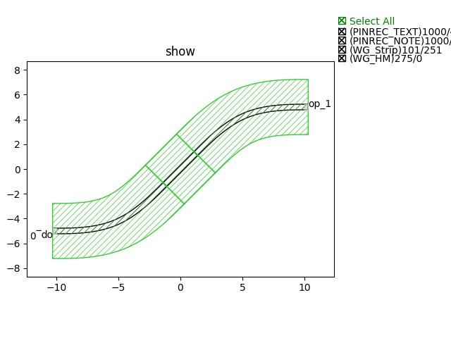
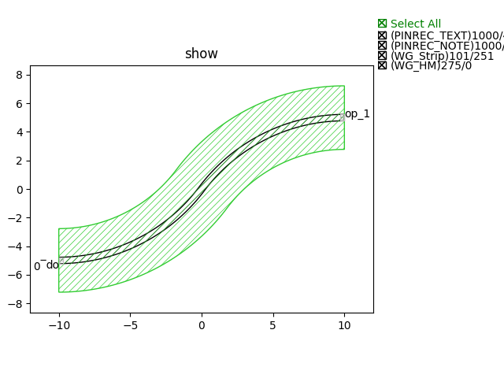
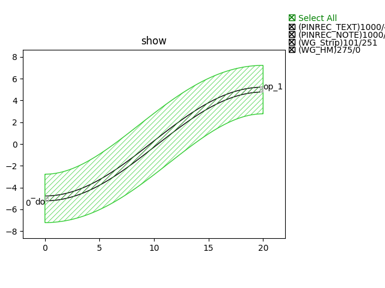

SBend
#############################

SBend
**********************************************************

+----------------+-----------------+------------------------------------------------------------------------------------+
| Parameters     | Range           | Description                                                                        |
+================+=================+====================================================================================+
|distance        |  > 0            | Horizontal distance of SBend                                                       |
+----------------+-----------------+------------------------------------------------------------------------------------+
|height          |  != 0           | Height of Sbend                                                                    |
+----------------+-----------------+------------------------------------------------------------------------------------+
|bend_degrees    |  (0, 180)       | Bending waveguide angle at the ends of SBend                                       |
+----------------+-----------------+------------------------------------------------------------------------------------+
|max_distance    |  > 0            | Maximum horizontal distance for SBend                                              |
+----------------+-----------------+------------------------------------------------------------------------------------+
|bend_factory    |  --             | Bending types for SBend                                                            |
+----------------+-----------------+------------------------------------------------------------------------------------+

+-------------------+-----------------------------+-------------+
|     ports         |   default waveguide type    | orientation |
+===================+=============================+=============+
| op_0              | TECH.WG.STRIP.C.WIRE        | 180         |
+-------------------+-----------------------------+-------------+
| op_1              | TECH.WG.STRIP.C.WIRE        | 0           |
+-------------------+-----------------------------+-------------+

SBendCircular
**********************************************************

+----------------+-----------------+------------------------------------------------------------------------------------+
| Parameters     | Range           | Description                                                                        |
+================+=================+====================================================================================+
|distance        |  > 0            | Horizontal distance of SBend                                                       |
+----------------+-----------------+------------------------------------------------------------------------------------+
|height          |  != 0           | Height of Sbend                                                                    |
+----------------+-----------------+------------------------------------------------------------------------------------+
|min_radius      |  > 0            | Minimum radius of SBend                                                            |
+----------------+-----------------+------------------------------------------------------------------------------------+

+-------------------+-----------------------------+-------------+
|     ports         |   default waveguide type    | orientation |
+===================+=============================+=============+
| op_0              | TECH.WG.STRIP.C.WIRE        | 180         |
+-------------------+-----------------------------+-------------+
| op_1              | TECH.WG.STRIP.C.WIRE        | 0           |
+-------------------+-----------------------------+-------------+

SBendCosine
**********************************************************

+----------------+-----------------+------------------------------------------------------------------------------------+
| Parameters     | Range           | Description                                                                        |
+================+=================+====================================================================================+
|distance        |  > 0            | Horizontal distance of SBend                                                       |
+----------------+-----------------+------------------------------------------------------------------------------------+
|height          |  != 0           | Height of Sbend                                                                    |
+----------------+-----------------+------------------------------------------------------------------------------------+

+-------------------+-----------------------------+-------------+
|     ports         |   default waveguide type    | orientation |
+===================+=============================+=============+
| op_0              | TECH.WG.STRIP.C.WIRE        | 180         |
+-------------------+-----------------------------+-------------+
| op_1              | TECH.WG.STRIP.C.WIRE        | 0           |
+-------------------+-----------------------------+-------------+
