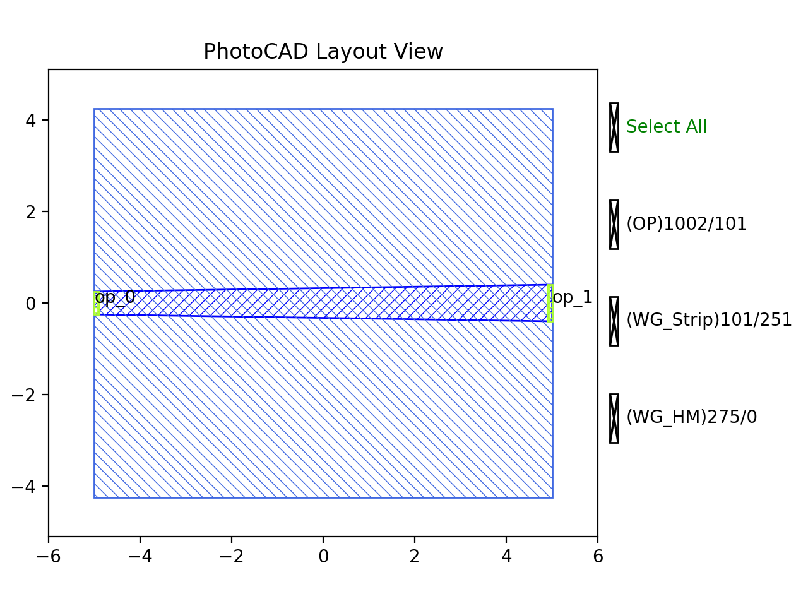

Taper
#############################

TaperLinear
**********************************************************

+----------------+-----------------+------------------------------------------------------------------------------------+
| Parameters     | Range           | Description                                                                        |
+================+=================+====================================================================================+
|length          |  > 0            | Length of Taper                                                                    |
+----------------+-----------------+------------------------------------------------------------------------------------+
|left_type       |  --             | Type of waveguide of start                                                         |
+----------------+-----------------+------------------------------------------------------------------------------------+
|left_type       |  --             | Type of waveguide of end                                                           |
+----------------+-----------------+------------------------------------------------------------------------------------+

+-------------------+-----------------------------+-------------+
|     ports         |   default waveguide type    | orientation |
+===================+=============================+=============+
| op_0              | TECH.WG.STRIP.C.WIRE        | 180         |
+-------------------+-----------------------------+-------------+
| op_1              | TECH.WG.STRIP.C.WIRE        | 0           |
+-------------------+-----------------------------+-------------+

