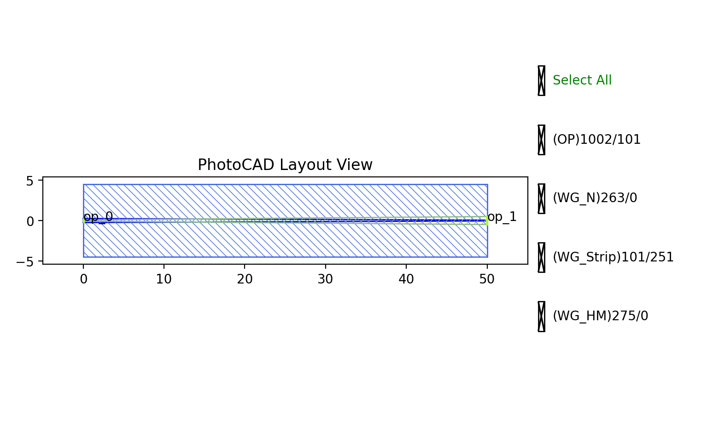

Transition
#############################

    The transition component is still in the development stage, so its performance cannot be guaranteed.
    Specific performance will be subject to the measured data.

STRIP2SIN_STRIPTransition
*******************************************

+--------------+--------------------------------+-------------------------------------------------------------------------+
| Parameters   | Range                          | Description                                                             |
+==============+================================+=========================================================================+
| total_length | > 0                            | Length of both tapers                                                   |
+--------------+--------------------------------+-------------------------------------------------------------------------+
| start_type   | ``WG.STRIP``                   | Input STRIP waveguide type                                              |
+--------------+--------------------------------+-------------------------------------------------------------------------+
| end_type     | ``WG.SIN_STRIP``               | Output SIN_STRIP waveguide type                                         |
+--------------+--------------------------------+-------------------------------------------------------------------------+
| end_width1   | > 0                            | Silicon taper tip width at the output                                   |
+--------------+--------------------------------+-------------------------------------------------------------------------+
| end_width2   | > 0                            | Silicon nitride taper tip width at the input                            |
+--------------+--------------------------------+-------------------------------------------------------------------------+

+-------+--------------------------+-------------+
| ports | default waveguide type   | orientation |
+=======+==========================+=============+
| op_0  | TECH.WG.STRIP.C.WIRE     | 180         |
+-------+--------------------------+-------------+
| op_1  | TECH.WG.SIN_STRIP.C.WIRE | 0           |
+-------+--------------------------+-------------+

