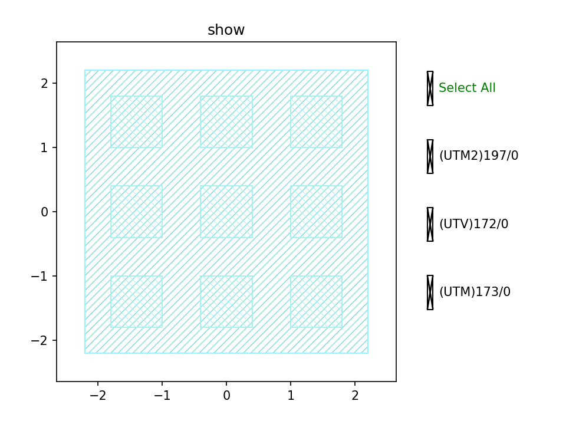

Via
############################################

ViaArray
**********************************************************

+----------------+---------------------+-----------------------------------------------------------------------------------+
| Parameters     | Default             | Description                                                                       |
+================+=====================+===================================================================================+
| cols           | 3                   | Cols of array of via                                                              |
+----------------+---------------------+-----------------------------------------------------------------------------------+
| rows           | 3                   | Rows of array of via                                                              |
+----------------+---------------------+-----------------------------------------------------------------------------------+
| spacing        | VIAS.SPACING        | Spacing between vias in array                                                     |
+----------------+---------------------+-----------------------------------------------------------------------------------+
| top_layer      | LAYER.UTM2          | Upper metal layer                                                                 |
+----------------+---------------------+-----------------------------------------------------------------------------------+
| via_layer      | LAYER.UTV           | Via layer                                                                         |
+----------------+---------------------+-----------------------------------------------------------------------------------+
| bottom_layer   | LAYER.UTM           | Lower metal layer                                                                 |
+----------------+---------------------+-----------------------------------------------------------------------------------+
| top_shape      | VIAS.TOP_SHAPE      | Upper metal shape                                                                 |
+----------------+---------------------+-----------------------------------------------------------------------------------+
| via_shape      | VIAS.VIA_SHAPE      | Via shape                                                                         |
+----------------+---------------------+-----------------------------------------------------------------------------------+
| bottom_shape   | VIAS.BOTTOM_SHAPE   | Bottom metal shape                                                                |
+----------------+---------------------+-----------------------------------------------------------------------------------+
| top_enclosed   | VIAS.TOP_ENCLOSED   | The distance of the via layer being enclosed within the upper metal layer         |
+----------------+---------------------+-----------------------------------------------------------------------------------+
| bottom_enclosed| VIAS.BOTTOM_ENCLOSED| The distance of the via layer being enclosed within the lower metal layer         |
+----------------+---------------------+-----------------------------------------------------------------------------------+
